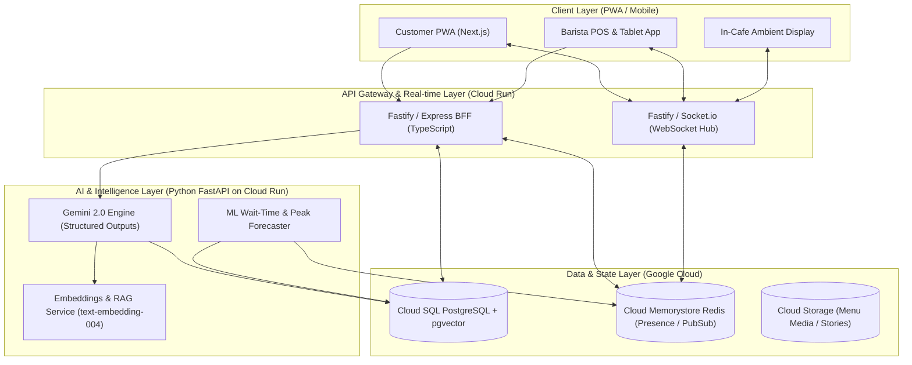

# ☕ Cafe Companion: The Intelligent Third Place Ecosystem

> **Transforming cafes into hyper-personalized, convenient, and connected social hubs for both guests and cafe teams.**

---

## 📖 Executive Summary & Vision

Cafes are more than just places to buy caffeine—they are our quintessential **"Third Places"** (spaces between home and work where community thrives). People visit cafes with distinct intentions:
- 💻 **Deep Work & Building:** Freelancers, students, and founders seeking Wi-Fi, power, focus fuel, and serendipitous networking.
- 💬 **Unwinding & Socializing:** Friends catching up, casual readers, people-watchers looking for cozy aesthetics.
- 🤝 **Intentional Networking:** Professionals and creatives open to coffee chats, peer feedback, or co-working buddies.
- ☕ **Cafe Teams & Baristas:** Fast-paced hospitality workers striving to balance order speed, beverage craftsmanship, ambient room comfort, and hospitality.

**Cafe Companion** merges the convenience and loyalty of **Starbucks**, the proximity-based serendipity of **Tinder/Bumble**, and the visual discovery of **Instagram**, all powered by **Google Gemini AI** and **Google Cloud Platform (GCP)**.

---

## 🌟 The 5 Core Pillars

```
+-----------------------------------------------------------------------------------+
|                                CAFE COMPANION                                     |
+-----------------------------------------------------------------------------------+
|  1. Smart Ordering       |  2. Better Waits        |  3. Connect People ("Cafe Mode") |
|  - Conversational AI     |  - ML Queue Forecast    |  - Geofenced Opt-In Cards        |
|  - Multimodal Snap-Order |  - "Best Time" Heatmap  |  - Mutual Interest Icebreakers   |
|  - Dietary Guardrails    |  - Geofenced Prep Pings |  - "Send a Coffee" Micro-Gift    |
+--------------------------+-------------------------+----------------------------------+
|  4. Understand the Room  |  5. Personalized Taste Discovery                          |
|  - Ambient Vibe Sensor   |  - Dynamic Mood & Weather Matrix                         |
|  - Instant Micro-Feedback|  - Gemini Taste Vector Graph                             |
|  - Service Recovery Bot  |  - Instagram-Style Vertical Video Drops                  |
+-----------------------------------------------------------------------------------+
```

---

### 1. Smart Ordering (Conversational, Preferences & Recommendations)
*Inspirations: Starbucks Mobile Ordering & Customization Engine + Gemini 2.0 Multimodal Live & Tool Calling*

- **Natural Language & Voice Ordering:**
  - Customers can order naturally: *"Get me a double-shot iced flat white with oat milk and just a splash of sugar-free vanilla, plus something savory that is gluten-free."*
  - **Gemini Function Calling** extracts structured line items, calculates modifier prices, checks real-time inventory, and displays a confirmed cart.
- **Multimodal Visual Snap-to-Order (Instagram Inspiration):**
  - Spot someone enjoying a gorgeous layered matcha or artisanal pastry? Snap a photo. Gemini Vision maps it directly to the cafe’s actual menu item and suggests exact recipe tags.
- **Dietary & Allergy Protection:**
  - Dynamic user profile memory (celiac, vegan, lactose-intolerant, keto). Gemini automatically warns if a selected syrup contains dairy or a pastry was cross-contaminated with tree nuts.
- **Quick-Reorder & "The Usual" Shortcuts:**
  - One-tap reorder from home screen or lock screen widget when entering the cafe's geofence.

---

### 2. Better Waits & Crowd Forecaster
*Inspirations: Google Maps Popular Times + Flight Radar Live Tracking*

- **Precision Preparation Time Engine:**
  - Queue prediction isn't just an average; it's calculated using:
    $$\text{Wait Time} = \sum (\text{Prep Complexity Score}) \div (\text{Active Baristas}) + \text{Kitchen Queue Buffer}$$
  - A complex pour-over or grilled panini dynamically adds more realistic minutes than an iced cold brew.
- **"Best Time to Visit" Density Heatmap:**
  - Real-time occupancy status:
    - 🟢 *Cozy & Quiet Focus Vibe (Plenty of tables & outlets available)*
    - 🟡 *Bustling & Energetic (Great for networking, few tables left)*
    - 🔴 *Peak Rush (Grab & Go recommended)*
  - Forecasts table turnover: *"3 tables expected to open up around 2:15 PM based on average visit length."*
- **Geofenced Freshness Trigger (Crema Protection):**
  - Order ahead while commuting. Baristas pull the espresso shot only when your phone enters a 300m radius, ensuring drinks never sit cold and soggy on the pickup counter.

---

### 3. Connect People ("Cafe Mode" Proximity Social)
*Inspirations: Tinder / Bumble BFF + LinkedIn Local Networking*

- **Privacy-First Geofenced "Cafe Mode":**
  - **Zero Creepiness Guarantee:** Only accessible when physically checked into the cafe (via table QR code, Wi-Fi captive handshake, or geofence).
  - Profiles automatically disappear the second the user leaves the cafe.
- **Micro-Badges & Status Chips:**
  - Users toggle custom badges:
    - 💼 *Goal:* "Building an AI startup", "Writing a screenplay", "Studying for MCAT", "Casual reading"
    - 🟢 *Status:* "Open to coffee chats (15m)", "Looking for UI feedback", "In the zone (Do Not Disturb)"
- **Double Opt-In "Coffee Spark":**
  - Browse swipeable cards of people at the cafe. Both parties must tap **"Say Hi"** or **"Share Table"** to open a connection.
- **Gemini Icebreaker Generator:**
  - Once mutually matched, Gemini suggests a contextual, non-awkward prompt:
    > *"Alex and Jordan: You both love Figma and indie game design. Ask Jordan about their favorite pixel art tool!"*
- **"Buy Them a Coffee" Micro-Gifting:**
  - Send an anonymous or signed coffee/pastry coupon to someone's table as an appreciative gesture.

---

### 4. Understand the Room (Ambient Sentiment & Barista Operations)
*Inspirations: Uber 1-tap feedback + Airline Operation Dispatch + Sentiment AI*

- **Instant Ambient Micro-Feedback:**
  - Simple 1-tap feedback tags on the digital receipt or PWA banner:
    - ❄️ *Too Cold / AC high* | 🔊 *Music too loud* | 📶 *Wi-Fi lagging* | 🪑 *Need more power outlets*
- **Gemini Barista Copilot (Operational Telemetry):**
  - Aggregates feedback streams and notifies staff discreetly on their tablet/watch:
    - *"Notice: 3 guests in the mezzanine mentioned freezing AC. Suggested action: Set thermostat to 22°C."*
    - *"Vibe check: Morning work rush winding down. Recommend shifting Spotify playlist from Lo-Fi Beats to Indie Acoustic."*
- **Proactive Automated Service Recovery:**
  - If ticket prep time exceeds the promised window by >8 minutes, Gemini triggers an automated apology notification and a complimentary reward (e.g., free pastry or 20% off next visit) directly to the customer's phone before frustration turns into a 1-star Yelp/Google review.

---

### 5. Hyper-Personalized Discovery
*Inspirations: Spotify Discover Weekly + Instagram Stories / Reels*

- **The "Digital Veteran Barista" Memory:**
  - Remembers that you love light-roast Ethiopian pour-overs with floral notes, prefer plant milk, and usually switch to decaf or herbal tea after 3:00 PM.
- **Dynamic Context Matrix:**
  - Recommends items based on multi-variate context:
    - 🌧️ *Weather:* Cold & raining $\rightarrow$ Cardamom spiced latte or warm soup.
    - ⏰ *Time of Day & Productivity:* 10:00 AM $\rightarrow$ High-protein breakfast sandwich + nitro cold brew for focus.
    - 💡 *Mood Slider:* "Need Energy", "Sweet Craving", "Calm & Grounding", "Healthy & Clean".
- **Visual Story Menu (Instagram-Style Vertical Drops):**
  - Baristas can post 15-second ephemeral video stories of today's single-origin bean cupping, fresh sourdough loaves coming out of the oven, or secret off-menu drink builds.

---

## 🛠️ Tech Stack: Current vs. Recommended Improvements

| Layer | Original Stack | Proposed Production Upgrade | Why Upgrade? |
| :--- | :--- | :--- | :--- |
| **Frontend** | React | **Next.js 15 (React 19) + PWA + Tailwind CSS + Framer Motion** | Zero-download barrier via QR code web app; PWA allows push notifications & offline caching; Framer Motion for Tinder swipe cards. |
| **Mobile (Optional)**| - | **React Native / Expo** | Reuses TypeScript logic for dedicated regular customers desiring iOS/Android widgets & Apple Pay/Google Pay. |
| **Realtime BFF** | Express (TS) | **Fastify / Node.js (TypeScript) + Socket.io** | 2-3x higher throughput than Express; native schema validation; WebSockets for live wait times and Cafe Mode matches. |
| **AI & ML Engine** | Python | **FastAPI (Python 3.12) + Google GenAI SDK** | Native async endpoints; deep integration with Gemini 2.0 Flash/Pro, structured JSON schemas, and vector processing. |
| **Database** | Unspecified | **PostgreSQL (Google Cloud SQL) + `pgvector`** | Relational integrity for orders/payments + high-performance vector embeddings for flavor profiles and user networking matches. |
| **Cache & Presence**| Unspecified | **Redis (Memorystore on GCP)** | Sub-millisecond transient session state ("Who is in the cafe right now?"), rate limiting, and pub/sub. |
| **Hosting & Cloud** | Unspecified | **Google Cloud Platform (Cloud Run, Cloud Pub/Sub, Cloud Storage)** | Fully serverless containers, scales to zero when cafe is closed at night; near-zero maintenance overhead. |

---

## 🏗️ System Architecture Diagram



---

## 🤖 Deep Dive: Gemini AI Implementation Blueprint

### 1. Conversational Ordering with Gemini Function Calling
When a user speaks or chats: *"Hey, can I get two large iced oat lattes, one with decaf, and a warm chocolate croissant?"*

```python
# python_backend/ai/order_agent.py
import json
from google import genai
from google.genai import types

client = genai.Client()

def extract_structured_order(user_transcript: str, cafe_menu_json: str):
    prompt = f"""
    You are the Cafe Companion Smart Barista.
    Extract the customer's order into structured JSON according to the available cafe menu:
    Menu: {cafe_menu_json}
    Customer Request: "{user_transcript}"
    
    Handle ambiguities, missing options (e.g. ask for milk type if omitted), and extract items accurately.
    """
    
    response = client.models.generate_content(
        model="gemini-2.0-flash",
        contents=prompt,
        config=types.GenerateContentConfig(
            response_mime_type="application/json",
            response_schema={
                "type": "OBJECT",
                "properties": {
                    "items": {
                        "type": "ARRAY",
                        "items": {
                            "type": "OBJECT",
                            "properties": {
                                "item_id": {"type": "STRING"},
                                "name": {"type": "STRING"},
                                "quantity": {"type": "INTEGER"},
                                "customizations": {
                                    "type": "OBJECT",
                                    "properties": {
                                        "milk": {"type": "STRING"},
                                        "size": {"type": "STRING"},
                                        "ice_level": {"type": "STRING"},
                                        "caffeine": {"type": "STRING"},
                                        "temperature": {"type": "STRING"}
                                    }
                                },
                                "special_instructions": {"type": "STRING"}
                            },
                            "required": ["item_id", "name", "quantity"]
                        }
                    },
                    "needs_clarification": {"type": "BOOLEAN"},
                    "clarification_question": {"type": "STRING"}
                },
                "required": ["items", "needs_clarification"]
            }
        )
    )
    return json.loads(response.text)
```

### 2. Social Matchmaking & Icebreaker Generation
Using vector embeddings to match shared interests while users are in **Cafe Mode**:

```python
# python_backend/ai/social_matcher.py
def generate_cafe_icebreaker(user_a_profile: dict, user_b_profile: dict) -> str:
    prompt = f"""
    Two cafe patrons have mutually opted into 'Cafe Mode' at the same coffee shop:
    User A: {user_a_profile['name']}, Profession: {user_a_profile['role']}, Working On: {user_a_profile['current_project']}, Interests: {user_a_profile['interests']}
    User B: {user_b_profile['name']}, Profession: {user_b_profile['role']}, Working On: {user_b_profile['current_project']}, Interests: {user_b_profile['interests']}
    
    Write a 1-sentence, charming, low-pressure, friendly icebreaker that bridges their common ground.
    Do NOT sound corporate or overly romantic. Keep it casual, cafe-appropriate, and engaging.
    """
    
    response = client.models.generate_content(
        model="gemini-2.0-flash",
        contents=prompt,
        config=types.GenerateContentConfig(
            temperature=0.7,
            max_output_tokens=100
        )
    )
    return response.text.strip()
```

### 3. Ambient Room Feedback & Sentiment Analyzer
```python
# python_backend/ai/room_sentiment.py
def analyze_room_telemetry(feedback_logs: list[dict], current_ambient_data: dict) -> dict:
    prompt = f"""
    Analyze the real-time operational feedback from cafe patrons over the last 30 minutes:
    Feedbacks: {json.dumps(feedback_logs)}
    Sensor / Audio Ambient Data: {json.dumps(current_ambient_data)}
    
    Synthesize operational insights for the cafe manager.
    Provide actionable steps (e.g. thermostat adjustments, music change, table cleaning, barista pacing).
    """
    
    response = client.models.generate_content(
        model="gemini-2.0-flash",
        contents=prompt,
        config=types.GenerateContentConfig(
            response_mime_type="application/json",
            response_schema={
                "type": "OBJECT",
                "properties": {
                    "vibe_summary": {"type": "STRING"},
                    "overall_sentiment_score": {"type": "NUMBER"}, # -1.0 to 1.0
                    "immediate_alerts": {
                        "type": "ARRAY",
                        "items": {
                            "type": "OBJECT",
                            "properties": {
                                "urgency": {"type": "STRING", "enum": ["LOW", "MEDIUM", "HIGH"]},
                                "category": {"type": "STRING", "enum": ["TEMPERATURE", "MUSIC", "CLEANLINESS", "SPEED", "WIFI"]},
                                "message": {"type": "STRING"},
                                "suggested_action": {"type": "STRING"}
                            },
                            "required": ["urgency", "category", "message", "suggested_action"]
                        }
                    }
                },
                "required": ["vibe_summary", "overall_sentiment_score", "immediate_alerts"]
            }
        )
    )
    return json.loads(response.text)
```

---

## 🗄️ Database Schema Design (PostgreSQL + pgvector)

```sql
-- Extensions
CREATE EXTENSION IF NOT EXISTS "uuid-ossp";
CREATE EXTENSION IF NOT EXISTS "vector";

-- Users
CREATE TABLE users (
    id UUID PRIMARY KEY DEFAULT uuid_generate_v4(),
    full_name VARCHAR(100) NOT NULL,
    email VARCHAR(255) UNIQUE NOT NULL,
    phone VARCHAR(30),
    avatar_url TEXT,
    dietary_preferences JSONB DEFAULT '{"vegan": false, "gluten_free": false, "nut_allergy": false}',
    taste_embedding vector(768),
    created_at TIMESTAMP WITH TIME ZONE DEFAULT NOW()
);

-- Cafe Locations
CREATE TABLE cafes (
    id UUID PRIMARY KEY DEFAULT uuid_generate_v4(),
    name VARCHAR(150) NOT NULL,
    slug VARCHAR(100) UNIQUE NOT NULL,
    address TEXT NOT NULL,
    latitude DOUBLE PRECISION NOT NULL,
    longitude DOUBLE PRECISION NOT NULL,
    wifi_ssid VARCHAR(100),
    operating_hours JSONB,
    current_occupancy_status VARCHAR(50) DEFAULT 'NORMAL'
);

-- Active Cafe Check-ins (Presence Engine)
CREATE TABLE cafe_presence (
    id UUID PRIMARY KEY DEFAULT uuid_generate_v4(),
    user_id UUID REFERENCES users(id) ON DELETE CASCADE,
    cafe_id UUID REFERENCES cafes(id) ON DELETE CASCADE,
    table_number VARCHAR(20),
    is_cafe_mode_active BOOLEAN DEFAULT false,
    networking_badge VARCHAR(100),       -- e.g. "Building AI / Coffee Chat"
    looking_for VARCHAR(255),           -- e.g. "Looking for feedback on UI"
    social_embedding vector(768),       -- Embedding of current goals & interests
    checkin_time TIMESTAMP WITH TIME ZONE DEFAULT NOW(),
    expires_at TIMESTAMP WITH TIME ZONE NOT NULL,
    UNIQUE(user_id, cafe_id)
);

-- Orders
CREATE TABLE orders (
    id UUID PRIMARY KEY DEFAULT uuid_generate_v4(),
    cafe_id UUID REFERENCES cafes(id),
    customer_id UUID REFERENCES users(id),
    status VARCHAR(50) DEFAULT 'QUEUED', -- QUEUED, BREWING, READY, COMPLETED, CANCELLED
    order_type VARCHAR(30) DEFAULT 'DINE_IN', -- DINE_IN, TAKEAWAY, TABLE_SERVICE
    table_number VARCHAR(20),
    total_amount NUMERIC(10, 2) NOT NULL,
    items JSONB NOT NULL,
    estimated_wait_seconds INT NOT NULL,
    actual_prep_seconds INT,
    created_at TIMESTAMP WITH TIME ZONE DEFAULT NOW(),
    completed_at TIMESTAMP WITH TIME ZONE
);

-- Ambient Feedback & Telemetry
CREATE TABLE room_feedback (
    id UUID PRIMARY KEY DEFAULT uuid_generate_v4(),
    cafe_id UUID REFERENCES cafes(id),
    user_id UUID REFERENCES users(id),
    category VARCHAR(50) NOT NULL,      -- 'TEMPERATURE', 'VOLUME', 'WIFI', 'VIBE'
    sentiment_tag VARCHAR(50) NOT NULL,  -- 'TOO_COLD', 'TOO_LOUD', 'PERFECT', 'COZY'
    comment TEXT,
    created_at TIMESTAMP WITH TIME ZONE DEFAULT NOW()
);
```

---

## 🔒 Privacy, Safety & Ethical Guardrails

1. **Ephemeral Presence:**
   - Social cards are active strictly within physical geofence / Wi-Fi range. Once disconnected for 15 minutes, the presence record is purged.
2. **Double Opt-in Only:**
   - No direct messaging without mutual consent. If one user passes, the other user is never informed.
3. **Block & Discreet Report:**
   - One-tap flagging removes unwanted interactions immediately and alerts the cafe staff if someone is causing a disturbance.
4. **DND Mode ("In The Zone"):**
   - For patrons who just want to crush work in peace, a single switch hides their profile and suppresses all social notifications.

---

## 🚀 Implementation Roadmap (4 Phases)

### Phase 1: MVP Foundation (Weeks 1-3)
- [x] Next.js 15 PWA with mobile-responsive QR-code ordering interface.
- [x] Fastify / Express TypeScript backend with PostgreSQL (Cloud SQL).
- [x] Digital menu catalog, table selection, and basic Stripe payment integration.
- [x] Barista Kitchen Display System (KDS) showing ticket queue.

### Phase 2: Gemini AI Integration (Weeks 4-6)
- [x] Natural language conversational order parsing using Gemini 2.0 Flash + Function Calling.
- [x] Algorithmic wait-time estimator factoring in drink complexity and barista queue.
- [x] Multimodal "Snap-to-Order" image menu recognition.

### Phase 3: "Cafe Mode" Social Proximity & Vibe Telemetry (Weeks 7-9)
- [x] Opt-in Cafe Mode with profile chips, interests, and table check-ins.
- [x] Double opt-in matchmaking with Gemini-generated conversational icebreakers.
- [x] 1-tap ambient room feedback & Barista Alert Copilot for AC/music/cleanliness.

### Phase 4: Discovery & Scale on GCP (Weeks 10-12)
- [x] Instagram-style ephemeral Video Story Menu drops for daily specials.
- [x] Vector-based taste profile recommendations via `pgvector` and Gemini Embeddings.
- [x] Deploy containerized services on Google Cloud Run with Cloud Memorystore Redis.

---

## 💻 Recommended Project Directory Structure

```plaintext
Cafe-Companion-GCP/
├── frontend/                     # Next.js 15 PWA (Client & Barista KDS)
│   ├── src/
│   │   ├── app/                 # App Router (routes: /order, /cafe-mode, /kds, /stories)
│   │   ├── components/          # UI Components (Cards, SwipeDeck, Cart, AudioWave)
│   │   ├── hooks/               # useCafePresence, useSocket, useVoiceOrder
│   │   └── lib/                 # API client, Geofencing, Utils
│   ├── public/                  # Manifest, icons, audio assets
│   ├── tailwind.config.ts
│   └── package.json
│
├── backend-realtime/             # Fastify / Express TypeScript (BFF & WebSockets)
│   ├── src/
│   │   ├── controllers/         # Order, Cafe, Presence controllers
│   │   ├── sockets/             # Socket.io handlers for live queue & matches
│   │   ├── services/            # Database queries, Redis presence cache
│   │   └── server.ts
│   ├── tsconfig.json
│   └── package.json
│
├── backend-ai/                   # Python FastAPI (Gemini AI & Analytics)
│   ├── app/
│   │   ├── agents/              # Order Agent, Social Matcher, Sentiment Copilot
│   │   ├── core/                # Gemini client configuration, GCP Vertex AI
│   │   ├── routers/             # /api/ai/order, /api/ai/match, /api/ai/sentiment
│   │   └── main.py
│   ├── requirements.txt
│   └── Dockerfile
│
├── infra/                        # GCP Infrastructure & Deployment Scripts
│   ├── cloudrun-frontend.yaml
│   ├── cloudrun-backend.yaml
│   └── setup_cloud_sql.sh
│
├── CAFE_COMPANION_PLAN.md        # Comprehensive Architecture & Spec (This file)
└── README.md                     # Project overview & quickstart
```

---
*Created for Google Cloud Platform (GCP) & Gemini AI Ecosystem.*
